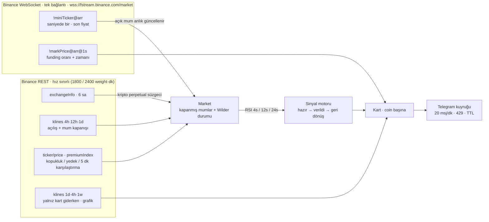

# RSI Botu

Binance USDT-M vadeli **kripto** kontratlarında **4 saat · 12 saat · 24 saat RSI aynı anda** eşiği geçince
o coin için Telegram'a **ayrı bir kart** gönderen bot. Kartta RSI değerleri alt alta, fiyat, 24 saatlik
değişim, **funding** (oran + sonraki funding zamanı) ve istenirse **grafik** (Günlük / 4 saat / Haftalık) bulunur.
Eşikler ve tüm parametreler Telegram'daki ayar panelinden yönetilir.

- 🔴 **Aşırı alım:** seçili tüm zaman dilimlerinde RSI ≥ üst eşik (varsayılan 80; 85–90'a çıkarılabilir)
- 🟢 **Aşırı satım:** seçili tüm zaman dilimlerinde RSI ≤ alt eşik (varsayılan 20)
- **Anlık:** fiyatlar Binance WebSocket'ten saniyede bir gelir — şart oluştuğu an kart gider
- Coin şarta **girince bir kez** kart; RSI eşikten birkaç puan geri dönüp tekrar gelince yeniden
- İstenince (`/liste`) ve **periyodik** (varsayılan saat başı) şu an şartı sağlayanların listesi
- Hisse / ETF / emtia / döviz kontratları (ör. `SOXSUSDT`, `TSLAUSDT`, `XAUUSDT`) ve stablecoin'ler **izlenmez**

> Bilgi amaçlıdır, yatırım tavsiyesi değildir.

## Kart

```
🔴 #BTCUSDT · RSI aşırı alım
RSI 4 saat    84.2
RSI 12 saat   82.1
RSI 24 saat   80.5
💲 Fiyat: 67123.4 · 24 sa +%5.2
💸 Funding: +%0.0100 · 19:00'da (2 sa 15 dk sonra)
⏱ 20.10 16:45 · şart: 4s · 12s · 24s RSI ≥ 80
```

Grafik açıksa kart, mumlar + altında eşik çizgili RSI paneli olan bir görselle (açıklama olarak bu metin) gelir.

## Veri akışı



| Ne | Nasıl | Yük |
|---|---|---|
| Anlık fiyat | `!miniTicker@arr` — saniyede **bir** mesajda tüm değişen coinler | 450 coinde mesaj başı ≈ 1,2 ms → CPU ≈ %0,1 |
| Funding | `!markPrice@arr@1s` — oran (`r`) ve sonraki funding zamanı (`T`) | aynı bağlantı |
| Mumlar | Açılışta coin başına 3 × 99 mum (weight 1); mum kapanınca 30 sn sonra o mum REST'ten kesinleşir | açılış ≈ 45 sn |
| Grafik | Yalnız kart giderken o coin + dilim için 1 istek (60 sn önbellek); **gönderim anında** çizilir | kuyrukta PNG birikmez |

Kline stream'leri (coin başına saniyede ~4 mesaj → 450 × 3 dilim ≈ 5000 mesaj/sn) bilerek kullanılmaz:
RSI için açık mumun son fiyatı yeterli, kesin kapanış REST'ten alınır.

**Kesintisiz akış** (scalp-bot altyapısından):
- **Watchdog:** 30 sn mesaj gelmezse bağlantı yenilenir; üstel geri çekilme 1 → 30 sn; Binance'in 24 saatlik kopuşu otomatik.
- **Kopukluk tamamlama:** yeniden bağlanınca fiyat + funding REST'ten alınır. Kopuklukta mumu kapanan coinler
  mumları REST'ten kesinleşene kadar **sinyal vermez** (kilit), sonra hemen değerlendirilir.
- **Yedek:** WebSocket 20 sn sessizse fiyatlar 15 sn'de bir REST'ten; mesaj gelince yedek kapanır.
- **Karşılaştırma:** WebSocket açıkken de 5 dk'da bir REST fiyat + funding — kaçan güncelleme kalmaz.
- **Telegram:** grup sınırı (20 msj/dk) ve 429 beklemesi; komut yanıtları kartların önüne geçer; 2 dk'dan uzun
  bekleyen karta "gecikmeli" etiketi; 20 dk'dan uzun bekleyen kart gönderilmez (bayat); kuyruk sınırı (bellek).

**RSI**: Wilder (RMA) — TradingView `ta.rsi` ile birebir (testte bağımsız Pine tanımıyla karşılaştırılır).
Varsayılan **anlık** (açık mum dahil), CoinGlass RSI ısı haritası ve TradingView gibi. **24 saat** = Binance
günlük mumu (03:00 TSİ açılır), **12 saat** 03:00 / 15:00 TSİ.

**Açılışta ve eşik değişince kart yağmuru olmaz:** o an şartı sağlayanlar bir kez listelenir; kart yalnız şarta yeni girenler için.

## Proje yapısı

```
src/
  index.js              giriş noktası, kapanış
  config.js             ortam değişkenleri, zaman dilimleri, aralıklar
  core/
    rsi.js              Wilder RSI (durum + anlık mum adımı)
    market.js           coin × zaman dilimi mum durumu, mum kapanışı
    signals.js          sinyal motoru (saf, ağsız)
  exchange/
    binance.js          REST istemcisi, hız sınırlayıcı, kripto perpetual süzgeci, funding
    stream.js           WebSocket (watchdog, yeniden bağlanma, kopukluk bildirimi)
  telegram/
    client.js           gönderim kuyruğu (fotoğraflı kart, 429, TTL, öncelik), yetki, long polling
    commands.js         komutlar ve ayar paneli
  settings/
    defs.js             ayar tanımları (aralık, varsayılan, hazır değerler, açıklamalar)
    store.js            doğrulama + kalıcı JSON
  app/
    bot.js              akış: yükleme, WebSocket, kart, kopukluk/yedek, liste
    chart.js            kart grafiği (mumlar + RSI paneli, PNG)
    format.js           mesaj biçimleri
  assets/fonts/         DejaVu (grafik yazı tipi)
test/                   node:test — birim + sahte Binance REST/WebSocket ve Telegram ile uçtan uca
docs/KULLANIM.md        Telegram'dan kullanım kılavuzu
```

Bağımlılıklar: `ws` (WebSocket), `@napi-rs/canvas` (grafik; hazır derlenmiş). Canvas yüklenemezse kartlar grafiksiz gider.

## Kurulum (Fly.io)

1. Telegram'da [@BotFather](https://t.me/BotFather) → `/newbot` → token'ı al. Botu gruba ekle ve **yönetici** yap.
2. Grup ID'sini bilmiyorsan ilk kurulumda `TELEGRAM_CHAT_ID=-1` ver, deploy et ve gruba `/durum` yaz:
   `fly logs`'ta `Tanımsız sohbetten mesaj yok sayıldı: "Grup adı" ID -100…` satırı çıkar → o ID'yi
   `fly secrets set TELEGRAM_CHAT_ID=-100…` ile gir.
3. `fly.toml`'da `app` adını benzersiz yap (örn. `rsi-bot-musteri`), sonra:

```bash
fly launch --no-deploy --copy-config          # uygulamayı oluştur (fra bölgesi)
fly volumes create rsi_data --region fra --size 1
fly secrets set TELEGRAM_BOT_TOKEN=... TELEGRAM_CHAT_ID=-100...
fly deploy
fly scale count 1                             # tek kopya: iki kopya aynı kartı iki kez gönderir
fly logs                                      # "[WS] Bağlandı" ve "[BOT] RSI botu çalışıyor"
```

Güncelleme: `git pull && fly deploy`. Ayarlar diskte (`/data/settings.json`) olduğu için korunur.

| Ortam değişkeni | | |
|---|---|---|
| `TELEGRAM_BOT_TOKEN` | zorunlu | BotFather token'ı |
| `TELEGRAM_CHAT_ID` | zorunlu | grup ID'si (`-100…`) |
| `TELEGRAM_THREAD_ID` | isteğe bağlı | konulu grupta kartların gideceği konu |
| `TELEGRAM_ADMIN_IDS` | isteğe bağlı | ayar değiştirebilecek kullanıcı ID'leri (virgüllü); boşsa grubun yöneticileri |
| `BINANCE_API_KEY` | isteğe bağlı | gerekmez (herkese açık veri); tanımlıysa REST isteklerinde gönderilir |
| `BINANCE_WS_URL` | isteğe bağlı | WebSocket adresi (varsayılan `wss://fstream.binance.com/market/stream`) |
| `DATA_DIR` | isteğe bağlı | ayar dosyası klasörü (Fly'da `/data`) |
| `DISPLAY_TZ` | isteğe bağlı | saat dilimi (varsayılan `Europe/Istanbul`) |

**Bölge:** `fra` ya da `ams` olmalı — Binance Futures ABD IP'lerini engeller. Makine 512 MB (bot ≈ 120 MB + grafik payı).

## Telegram

| Komut | Kim | |
|---|---|---|
| `/ayarlar` | herkes görür, yönetici değiştirir | ayar paneli (aşağıda) |
| `/liste` | herkes | şu an şartı sağlayan coinler (en güçlüden) |
| `/rsi BTC` | herkes | coinin 4s / 12s / 24s RSI'ı, funding, şart durumu (+ grafik) |
| `/durum` | herkes | izlenen / hazır coin, veri kaynağı (WebSocket / REST yedeği), bugünkü kart sayısı |
| `/ayar anahtar değer` · `/ayar sifirla` | yönetici | komutla ayar — ör. `/ayar ustEsik 85`, `/ayar grafikTf 1w` |
| `/yardim` | herkes | komutlar ve ayar listesi |

### Ayar paneli

Tek mesaj, yerinde güncellenir:

```
[ 🔴 Aşırı alım: Açık ] [ Eşik ≥ 80 ✏️ ]
[ 🟢 Aşırı satım: Açık ] [ Eşik ≤ 20 ✏️ ]
[ ✅ 4 saat ] [ ✅ 12 saat ] [ ✅ 24 saat ]
[ 🖼 Grafik: Açık ]
[ ○ Günlük ] [ ◉ 4 saat ] [ ○ Haftalık ]
[ 🔔 Ses: Açık ] [ 📋 Liste: 1 saat ✏️ ]
[ ⚙️ Gelişmiş ] [ 📋 Şimdi listele ]
[ ✖️ Kapat ]
```

✏️ olanlar kendi sayfasında açılır: açıklama, hazır değerler (ör. 70 · 75 · 80 · 85 · 90), −5 / −1 / +1 / +5, varsayılan.
**Gelişmiş**: RSI periyodu, tekrar kart farkı, anlık mum, en az 24s hacim, tümünü sıfırla (onaylı).

| Anahtar | Varsayılan | Aralık | |
|---|---|---|---|
| `ustAktif` · `ustEsik` | açık · 80 | 50–99 | aşırı alım kartı, eşik (hepsi ≥) |
| `altAktif` · `altEsik` | açık · 20 | 1–50 | aşırı satım kartı, eşik (hepsi ≤) |
| `tf4h` · `tf12h` · `tf1d` | açık | | şarttaki zaman dilimleri (en az biri) |
| `grafik` · `grafikTf` | açık · `4h` | `1d` / `4h` / `1w` | kartta grafik, grafiğin zaman dilimi |
| `sesli` | açık | | kartlar bildirim sesiyle |
| `listeDk` | 60 | 0–1440 | periyodik liste (0 = kapalı; saat başına hizalı) |
| `rsiPeriod` | 14 | 2–50 | RSI periyodu |
| `resetPuan` | 5 | 1–30 | aynı coine yeni kart için RSI'ın eşikten geri dönmesi gereken puan |
| `anlik` | açık | | açık mum dahil / yalnız kapanmış mumlar |
| `minHacimM` | 0 | 0–1000 | yalnız 24s hacmi ≥ … milyon $ olan coinler (0 = tümü) |

## Geliştirme

```bash
npm ci                    # Node 22+; sürümler package-lock.json'dan
cp .env.example .env      # token ve grup ID'sini yaz
npm start
npm test                  # ağ gerekmez: sahte Binance REST + WebSocket ve Telegram
```

Testler: RSI'ın TradingView tanımıyla birebirliği ve Wilder'ın klasik örneği, mum kapanışı, sinyal döngüsü,
hisse/stablecoin süzgeci, 429 tekrar denemeleri, ayar kalıcılığı ve doğrulaması, fotoğraflı kart / bayat kart,
uçtan uca: WebSocket'ten ayrı kartlar, funding, grafik, kopma → REST tamamlama + kilit, REST yedeği, ayar paneli.

## Lisans

Tüm hakları saklıdır — bkz. [LICENSE](LICENSE).
