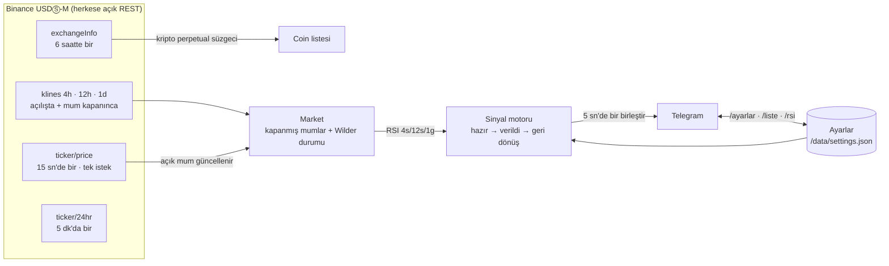

# RSI Botu

Binance USDT-M vadeli **kripto** kontratlarında **4 saat · 12 saat · 24 saat RSI aynı anda** eşiği geçince
Telegram'a bildirim gönderen bot. Grafik yok, yalnız RSI. Eşikler ve tüm parametreler Telegram'dan
(butonlu menü ya da komut) değiştirilir.

- 🔴 **Aşırı alım:** seçili tüm zaman dilimlerinde RSI ≥ üst eşik (varsayılan 80; 85–90'a çıkarılabilir)
- 🟢 **Aşırı satım:** seçili tüm zaman dilimlerinde RSI ≤ alt eşik (varsayılan 20)
- Coin şarta **girince bir kez** sinyal; RSI eşikten birkaç puan geri dönüp tekrar gelince yeniden
- Aynı anda şarta giren coinler **tek mesajda** birleşir
- İstenince (`/liste`) ve **periyodik** (varsayılan saat başı) şu an şartı sağlayanların listesi
- Hisse / ETF / emtia / döviz kontratları (ör. `SOXSUSDT`, `TSLAUSDT`, `XAUUSDT`) ve stablecoin'ler **izlenmez**

> Bilgi amaçlıdır, yatırım tavsiyesi değildir.

## Nasıl çalışır



- **RSI**: Wilder (RMA) — TradingView `ta.rsi` ile birebir (testte bağımsız Pine tanımıyla karşılaştırılır).
  Varsayılan **anlık**: açık (bitmemiş) mum da hesaba katılır, CoinGlass RSI ısı haritası ve TradingView gibi.
  Ayarlardan "kapanmış mum" seçilebilir.
- **24 saat** = Binance günlük mumu (00:00 UTC = 03:00 TSİ açılır). **12 saat** mumu 03:00 / 15:00 TSİ.
- **Veri**: her coin için açılışta 99 mum (Binance weight 1). RSI(14)'te 99 mum ile tüm geçmiş arasındaki
  fark 0.1 puanın altında (test). Fiyatlar 15 sn'de bir **tek istekle** alınır; mum kapanınca 30 sn sonra
  o mum REST'ten yeniden yüklenip kesinleştirilir.
- **Hız sınırı**: Binance istekleri sıraya girer (dakikada en fazla 1800 weight, sınır 2400);
  429 / Retry-After'da bekleyip tekrar dener. Telegram'da grup sınırı (20 mesaj/dk) ve 429 yönetilir.
- **Açılışta sinyal yağmuru olmaz**: o an şartı sağlayanlar listeyle bildirilir, sinyal yalnız şarta yeni girenler için.
  Eşik değişince de aynı.
- **Yeni listelenen coin**: günlük RSI için en az 15 günlük mum gerekir; o zamana kadar 24s seçiliyse şarta girmez.

## Proje yapısı

```
src/
  index.js              giriş noktası, kapanış
  config.js             ortam değişkenleri, zaman dilimleri, aralıklar
  core/
    rsi.js              Wilder RSI (durum + anlık mum adımı)
    market.js           coin × zaman dilimi mum durumu, mum kapanışı
    signals.js          sinyal motoru (saf, ağsız)
  exchange/
    binance.js          REST istemcisi, hız sınırlayıcı, kripto perpetual süzgeci
  telegram/
    client.js           gönderim kuyruğu, 429, yetki, long polling
    commands.js         komutlar ve butonlu ayar menüsü
  settings/
    defs.js             ayar tanımları (aralık, varsayılan, hazır değerler)
    store.js            doğrulama + kalıcı JSON
  app/
    bot.js              akış: yükleme, fiyat döngüsü, sinyal, liste
    format.js           mesaj biçimleri
test/                   node:test — birim + sahte Binance/Telegram ile uçtan uca
docs/KULLANIM.md        Telegram'dan kullanım kılavuzu
```

Harici npm bağımlılığı yoktur (Node 20+ yerleşik `fetch`).

## Kurulum (Fly.io)

1. Telegram'da [@BotFather](https://t.me/BotFather) → `/newbot` → token'ı al. Botu gruba ekle ve **yönetici** yap.
2. Grup ID'sini bilmiyorsan ilk kurulumda `TELEGRAM_CHAT_ID=-1` ver, deploy et ve gruba `/durum` yaz:
   `fly logs`'ta `Tanımsız sohbetten mesaj yok sayıldı: "Grup adı" ID -100…` satırı çıkar → o ID'yi
   `fly secrets set TELEGRAM_CHAT_ID=-100…` ile gir.
3. `fly.toml`'da `app` adını benzersiz yap (örn. `rsi-bot-musteri`), sonra:

```bash
fly launch --no-deploy --copy-config          # uygulamayı oluştur (fra bölgesi)
fly volumes create rsi_data --region fra --size 1
fly secrets set TELEGRAM_BOT_TOKEN=... TELEGRAM_CHAT_ID=-100...
fly deploy
fly logs                                      # "[BOT] RSI botu çalışıyor"
```

Güncelleme: `git pull && fly deploy`. Ayarlar diskte (`/data/settings.json`) olduğu için korunur.

| Ortam değişkeni | | |
|---|---|---|
| `TELEGRAM_BOT_TOKEN` | zorunlu | BotFather token'ı |
| `TELEGRAM_CHAT_ID` | zorunlu | grup ID'si (`-100…`) |
| `TELEGRAM_THREAD_ID` | isteğe bağlı | konulu grupta sinyallerin gideceği konu |
| `TELEGRAM_ADMIN_IDS` | isteğe bağlı | ayar değiştirebilecek kullanıcı ID'leri (virgüllü); boşsa grubun yöneticileri |
| `BINANCE_API_KEY` | isteğe bağlı | gerekmez; tanımlıysa isteklerle gönderilir |
| `DATA_DIR` | isteğe bağlı | ayar dosyası klasörü (Fly'da `/data`) |
| `DISPLAY_TZ` | isteğe bağlı | saat dilimi (varsayılan `Europe/Istanbul`) |

**Bölge:** `fra` ya da `ams` olmalı — Binance Futures ABD IP'lerini engeller.

## Telegram

| Komut | Kim | |
|---|---|---|
| `/liste` | herkes | şu an şartı sağlayan coinler (en güçlüden) |
| `/rsi BTC` | herkes | coinin 4s / 12s / 1g RSI'ı ve şart durumu |
| `/ayarlar` | herkes görür, yönetici değiştirir | butonlu menü: 🎯 Eşikler · ⏱ Zaman dilimleri · 🔔 Bildirim · 🌐 Coinler |
| `/ayar anahtar değer` · `/ayar sifirla` | yönetici | ör. `/ayar ustEsik 85`, `/ayar altEsik 15`, `/ayar tf1d kapat` |
| `/durum` | herkes | izlenen / hazır coin, son fiyat zamanı, bugünkü sinyal sayısı |
| `/yardim` | herkes | komutlar ve ayar listesi |

Komutlar yalnız `TELEGRAM_CHAT_ID` grubundan ya da yöneticinin bota özel mesajından kabul edilir.

### Ayarlar

| Anahtar | Varsayılan | Aralık | |
|---|---|---|---|
| `ustAktif` | açık | | aşırı alım sinyali |
| `ustEsik` | 80 | 50–99 | seçili dilimlerin hepsinde RSI ≥ |
| `altAktif` | açık | | aşırı satım sinyali |
| `altEsik` | 20 | 1–50 | seçili dilimlerin hepsinde RSI ≤ |
| `tf4h` · `tf12h` · `tf1d` | açık | | hangi zaman dilimleri şartta (en az biri) |
| `rsiPeriod` | 14 | 2–50 | RSI periyodu |
| `anlik` | açık | | açık mum dahil (anlık) / yalnız kapanmış mumlar |
| `resetPuan` | 5 | 1–30 | aynı coine yeniden sinyal için RSI'ın eşikten geri dönmesi gereken puan |
| `listeDk` | 60 | 0–1440 | periyodik liste aralığı (0 = kapalı; saat başına hizalı) |
| `sesli` | açık | | sinyaller bildirim sesiyle |
| `minHacimM` | 0 | 0–1000 | yalnız 24s hacmi ≥ … milyon $ olan coinler (0 = tümü) |

## Geliştirme

```bash
cp .env.example .env      # token ve grup ID'sini yaz
npm start
npm test                  # ağ gerekmez: sahte Binance + Telegram
```

Testler: RSI'ın TradingView tanımıyla birebirliği ve Wilder'ın klasik örneği, mum kapanışı, sinyal döngüsü
(şart → tekrar yok → geri dönüş → yeniden), hisse/stablecoin süzgeci, 429 tekrar denemeleri, ayar kalıcılığı,
yetki, butonlu menü ve uçtan uca akış.

## Lisans

Tüm hakları saklıdır — bkz. [LICENSE](LICENSE).
